

# Mauri-Citat

**A production football-pitch booking platform for Mauritania — built end-to-end with Flutter, Supabase and Firebase.**

Players book pitches in seconds. Pitch owners run their whole business from their phone. Supervisors handle the daily operations.

---

> **Note:** This is a showcase repository. Mauri-Citat is a live commercial product, so its source code is private. This page documents what was built, how it works, and the engineering behind it.

## 📱 Screenshots

<table>
  <tr>
    <td align="center">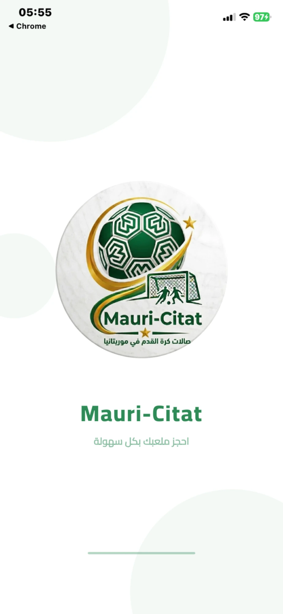 Splash</td>
    <td align="center">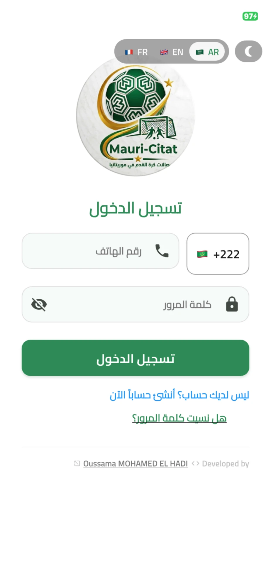 Login (3 languages, dark mode)</td>
    <td align="center">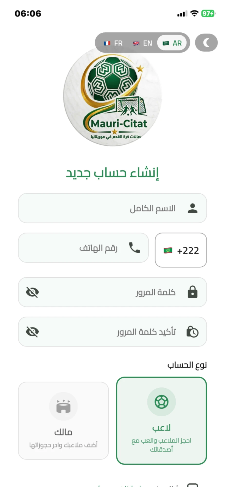 Sign-up with role choice</td>
    <td align="center">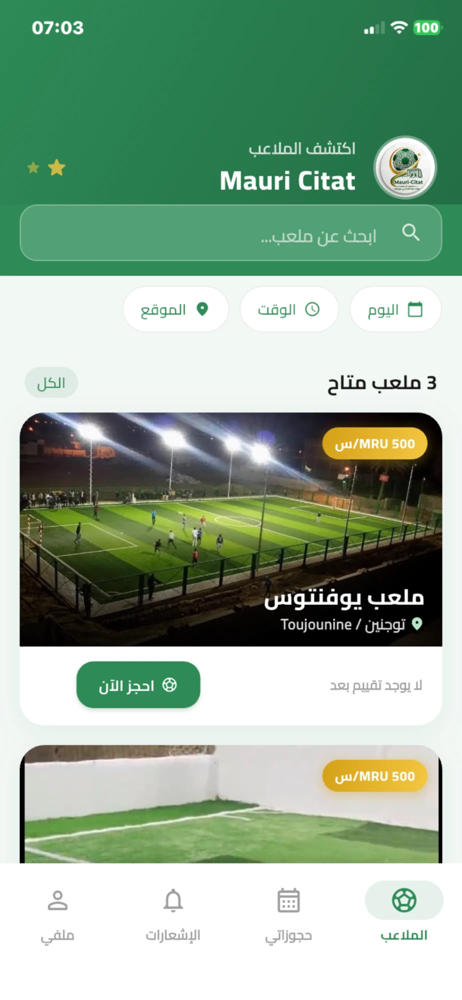 Discover pitches + filters</td>
  </tr>
  <tr>
    <td align="center">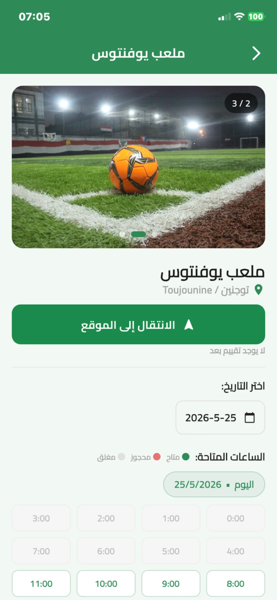 Pitch details &amp; live availability</td>
    <td align="center">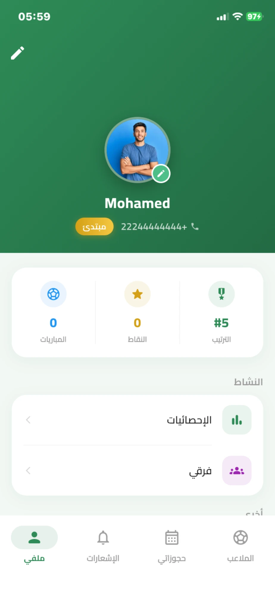 Player profile, points &amp; rank</td>
    <td align="center">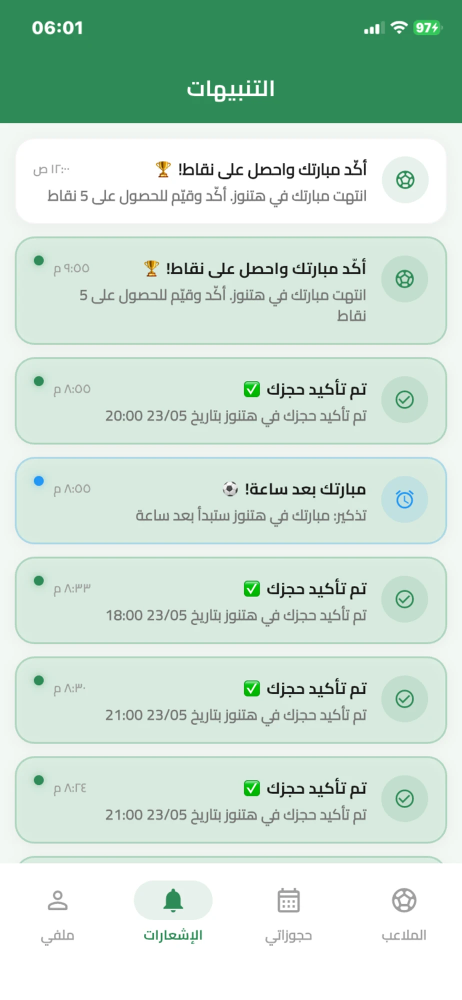 Notifications center</td>
    <td align="center">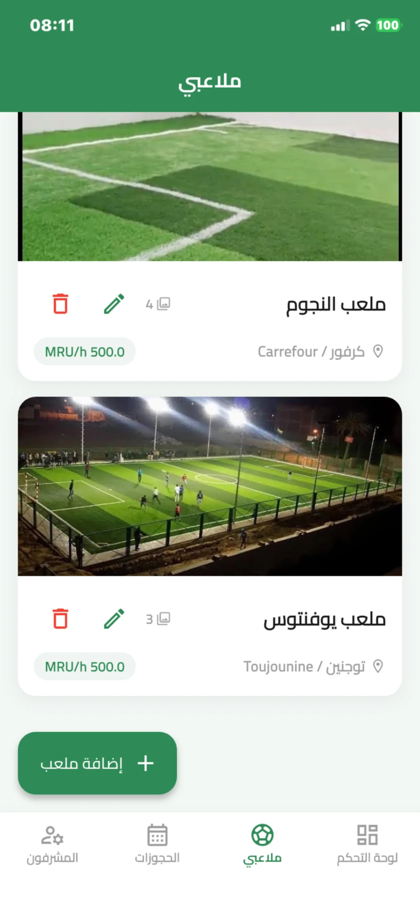 Owner: manage pitches</td>
  </tr>
  <tr>
    <td align="center">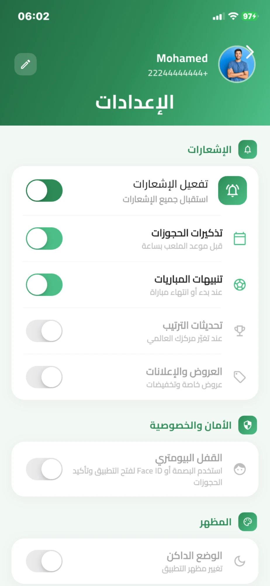 Settings &amp; biometric lock</td>
    <td align="center">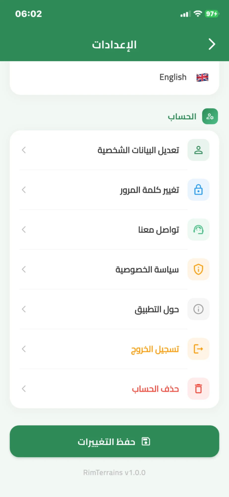 Account management</td>
    <td></td>
    <td></td>
  </tr>
</table>

## ✨ Features

### ⚽ For players
- **Find a pitch fast:** filter by city, zone, day and hour. The chosen city is remembered between sessions.
- **Book in seconds:** an hourly availability grid that updates in real time, with booked and closed slots marked.
- **Team bookings:** add teammates by phone number. Teammates who don't have the app yet get an **automatic SMS** with the match details and a download link.
- **Deposits:** pay a deposit through local mobile-payment apps (Bankily, Masrivi, Sedad, BimBank, Chinguitel Money) and upload the receipt.
- **Gamification:** confirm matches after playing, rate pitches and other players, earn points, and climb a **global leaderboard** (Beginner → Active → Pro → Legend).
- **Teams & community:** create teams, challenge other teams, and post "player needed" requests.

### 🏟️ For pitch owners
- **Dashboard:** monthly revenue, booking counts, today's matches, and a "needs your confirmation" queue that shows a **preview of the payment receipt**.
- **Pitch management:** a 4-step wizard covering name and price, photos, an exact map location, per-day opening hours, and deposit and payment settings.
- **Booker details:** the photo, name and phone number of whoever booked, with **one-tap calling**.
- **Manual bookings** for walk-in or phone customers. If the customer later signs up, those bookings are **linked to their account automatically**.
- **Supervisors with granular permissions:** manage bookings, collect cash, and create manual bookings. You can invite a supervisor **before they even have an account**, and the invitation activates when they register.

### 🧑‍💼 For supervisors
- A dashboard scoped to the pitches they've been assigned.
- What they can see and do is controlled by the owner, permission by permission.

### 🌍 Across the app
- **Arabic (RTL), French and English.** Pitch locations are stored as IDs, so place names translate along with the app language.
- **Dark mode**, **biometric lock** (Face ID / fingerprint), and **one-tap directions** to the pitch in your maps app.
- **Push notifications** for booking confirmations, match reminders, and "rate your match" prompts.
- **Phone-number login** with OTP codes sent over **WhatsApp**.

## 🏗️ Architecture

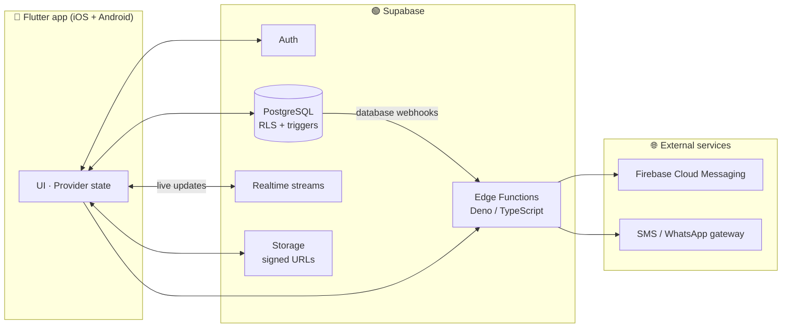

## 🔧 Engineering highlights

| Area | What was done |
|---|---|
| **Security** | Row-Level Security on every table. Privileged actions such as assigning supervisors or removing them go through `SECURITY DEFINER` functions with server-side guards, so an owner can't take over another owner's account even by calling the API directly. |
| **Business logic in the database** | Postgres triggers prevent double bookings, keep pitch ratings up to date, award points, apply supervisor invitations on sign-up, and link phone bookings to new accounts. |
| **Serverless backend** | Edge Functions (Deno/TypeScript) handle OTP verification, password resets, push notifications through the FCM v1 API (with OAuth token caching), and team SMS alerts. The SMS function guards against duplicate sends when several webhooks fire at once. |
| **Real-time** | The pitch list and user profiles are kept up to date with Supabase Realtime streams, and those streams are scoped and re-created correctly when the user switches accounts. |
| **Private files** | Payment receipts live in a private storage bucket and are only shown through short-lived signed URLs. |
| **Internationalization** | Full ARB-based localization in 3 languages with RTL layouts. Data such as cities and zones is translated through the database. |
| **Cost-aware messaging** | SMS text is kept within 2 Arabic segments, and a single smart download link sends each user to the right app store for their phone. |
| **Production delivery** | Release builds and store submissions for **Google Play** and the **App Store**, including Firebase App Check and iOS-specific release fixes. |

## 🧰 Tech stack

**Mobile:** Flutter · Dart · Provider · flutter_map · geolocator · local_auth · image_picker · shared_preferences
**Backend:** Supabase (PostgreSQL, Auth, Realtime, Storage, Edge Functions) · SQL migrations
**Cloud & messaging:** Firebase Cloud Messaging · Firebase App Check · WhatsApp / SMS gateway API
**Delivery:** Google Play Console · App Store Connect · GitHub Pages

## 💼 What I can build for you

I design and ship complete mobile products, from the database schema to the app store listing:

- **Cross-platform mobile apps** (iOS + Android) in Flutter
- **Booking, marketplace and multi-role apps**: customers, businesses, staff and admins
- **Supabase or Firebase backends** with proper security rules, triggers and serverless functions
- **Payments, OTP login, push notifications, SMS and WhatsApp integrations**
- **Multilingual and RTL apps** (Arabic · French · English)
- **Store publishing** and post-launch maintenance

## 📬 Contact

**Oussama Mohamed El Hadi** — Flutter & Supabase developer

- 💼 **Upwork:** [Hire me on Upwork](YOUR_UPWORK_PROFILE_URL)
- 📲 **Try the app:** [Google Play](https://play.google.com/store/apps/details?id=engs.mauri.citat) · [App Store](https://apps.apple.com/app/id6772883634)

---

© Mauri-Citat. Screenshots show test data.

